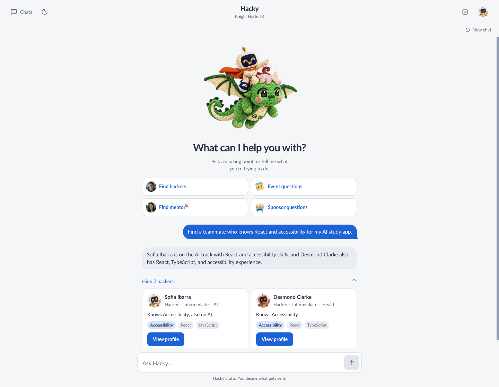
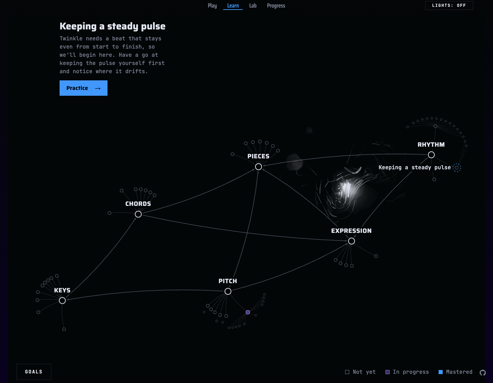

<picture>
  <source media="(max-width: 600px)" srcset="assets/header-mobile.svg?v=2" />
  
</picture>

<samp><a href="resume/Andres_Araque_Resume.pdf">Résumé ↗</a> · <a href="mailto:pipe.araque@gmail.com">Email</a></samp>

### Projects

<table>
  <tr>
    <td width="50%" valign="top"></td>
    <td width="50%" valign="top"></td>
  </tr>
  <tr>
    <td valign="top"><b>Hacky</b> Hackathons, built just for you</td>
    <td valign="top"><b>Étude</b> The piano tutor that knows you better than yourself</td>
  </tr>
</table>

#### [Hacky](https://github.com/seeko-codes/Hacky) · ~32 hours · Knight Hacks IX

Your hackathon, personalized. Hacky brings Knight Hacks' people, events, sponsors, and deadlines into one conversation. A Gemini agent navigates that context to find teammates and mentors who fit your goals, recommend events and sponsor opportunities for your project, and answer the practical questions of the weekend. Built-in messaging turns a promising match into a conversation.

I shaped the product and interface and used coding agents to build the prototype, React app, and conversational onboarding. A custom knit companion and a focused interface make the experience feel personal. Built by a three-person team. **[Try Hacky ↗](https://mlhacky.com)**

#### [Étude](https://github.com/Eric-Zhang-Developer/piano-arcade-gator-ai-days) · ~44 hours · Gator Hack V finalist

Sit at your piano. Étude takes care of what to practice. It chooses between learning something new and retrieving what you've learned, across both playing and music theory. A personal mastery graph guides it toward your gaps while scheduling review of earlier skills. Connected to a **real 88-key piano**, it turns that plan into practice on the instrument itself.

**I owned the entire learning architecture:** the 207-skill graph, evidence-driven mastery model, diagnostic, and planner context. Built with Eric Zhang and Sharan Santharam through agentic development. **[Explore Étude ↗](https://web-kohl-three-51.vercel.app/learn)**

#### [Donna](https://apps.apple.com/us/app/donna-social-intelligence/id6760481634) · On the App Store

Tell Donna what you want to do; she helps you meet the right people at UCF. I'm on the **founding development team**, building UI and backend logic and leading the current refactor toward an architecture agents can navigate and extend.

**[Website ↗](https://donnaai.co) · [App Store ↗](https://apps.apple.com/us/app/donna-social-intelligence/id6760481634)**

Build times are elapsed repository windows, rounded to the nearest hour. Hacky was a 36-hour hackathon; its later README edits are excluded. [Dates and method](BUILD_NOTES.md).

[Architecture and development notes →](PROJECTS.md)

### Currently building: Ultralearn

**Know where you stand. Know what to do next.**

I'm building a **stateful tutor for any learning domain, starting with SAT math**. The goal is to generalize the knowledge-graph approach explored in Étude: map a domain, track what each learner knows, and give the agent persistent context to decide what to teach and when to review.

Alongside the app, I'm building **[content-factory](https://github.com/seeko-codes/content-factory)**, an agent-driven content pipeline that learns from its own performance. It creates the visual math content for **[@ultralearns](https://www.instagram.com/ultralearns/)**.

**In development.** The product's home will be **ultralearn.xyz**.

### The systems behind the products

- **[seeko-stack](https://github.com/seeko-codes/seeko-stack)** - my current toolkit for coordinating coding agents, preserving context, and verifying changes. It replaces Turn to Life and builds on Kun Chen's Firstmate ecosystem.
- **[Skemify](https://github.com/seeko-codes/skemify-skill)** - an experimental tool for building semantic ontologies of domains.

### How I work

As execution gets cheaper, the differentiator is judgment: understanding the domain, choosing the right problem, and knowing what good looks like.

- **Clarity before execution.** Define the intended outcome, how the parts fit together, and the quality bar. Make that concrete enough to test, then ship and iterate as the work reveals more.
- **Context is architecture.** Keep working context small and task-relevant. Store decisions and knowledge durably, with clear entry points and progressive disclosure so agents can retrieve what they need when they need it.
- **Focused agents, explicit contracts.** Give each worker a bounded task, relevant context, appropriate tools, and a clear definition of done. The orchestrator coordinates the work without carrying every implementation detail.
- **Parallelize around dependencies.** Map what must happen first, then split independent work into parallel batches. Reassess after each batch; concurrency should increase verified throughput.
- **Close the quality loop.** Check integrated behavior against the original goal through review, tests, and real product use. Iterate until it meets the bar, then preserve the findings in the context and tools for the next run.

**Product stack:** TypeScript · React · Next.js · Vite · Electron · Python · PostgreSQL · Playwright · Vitest.

**Mathematical foundation:** AI & Machine Learning · Optimization Theory & Mathematical Modeling · Linear Algebra.
