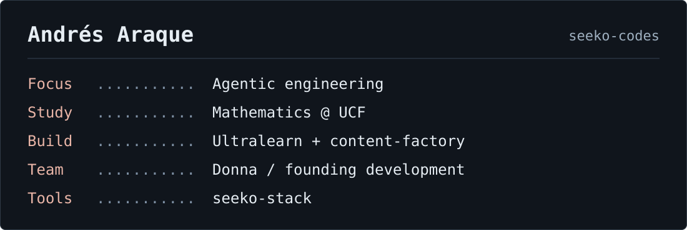

I'm a Mathematics student at **UCF**, building at the intersection of AI agents, product design, and learning.

My focus is **agentic engineering**: turning a product goal into a software factory with focused agent context, isolated worktrees, browser verification, and CI gates. The system keeps what each build teaches it, so the next run starts better informed.

### Selected work

| Project | What it does | Build / status |
| :--- | :--- | :--- |
| **[Hacky](https://github.com/seeko-codes/Hacky)** | A conversational AI that finds your next teammate, mentor, or connection at a hackathon. A custom knit mascot, rich matching cards, and a carefully crafted React interface. **[Try it ↗](https://mlhacky.com)** | **~32 hours** of product commits · Knight Hacks IX · team of 3 |
| **[Étude](https://github.com/Eric-Zhang-Developer/piano-arcade-gator-ai-days)** | A piano tutor and rhythm game for a real 88-key piano. An adaptive skill graph guides practice; MIDI input gives millisecond timing feedback. Built with Eric Zhang and Sharan Santharam. **[Play ↗](https://web-kohl-three-51.vercel.app)** | **~44 hours** · **Gator Hack V finalist** |
| **[Donna](https://apps.apple.com/us/app/donna-social-intelligence/id6760481634)** | An iOS app that helps people at UCF connect with the right person for what they want to do. | **On the App Store** |

Build times are elapsed repository windows, rounded to the nearest hour. Hacky was a 36-hour hackathon; its later README edits are excluded. [Dates and method](BUILD_NOTES.md).

### Currently building: Ultralearn

**Know where you stand. Know what to do next.**

An AI-guided learning app, starting with SAT math. A diagnostic maps what you know, and the app prepares your next useful step. The interface is living ink: it becomes the graph, the questions, and the work itself.

**In development.** Follow the build and visual math explanations at **[@ultralearns](https://www.instagram.com/ultralearns/)**. The product's home will be **ultralearn.xyz**.

### The systems behind the products

- **[seeko-stack](https://github.com/seeko-codes/seeko-stack)** - my portable distribution of Firstmate, with outcome-focused workflows, bounded loops, and an agent-assisted setup. Built on Kun Chen's Firstmate ecosystem.
- **[Turn to Life](https://github.com/seeko-codes/turn-to-life)** - a reusable, purpose-first agent workflow: clarify the goal, build against it, verify the result, and preserve what the work taught.
- **[Skemify](https://github.com/seeko-codes/skemify-skill)** - turn documents and records into an evidence-backed knowledge tree that an agent can navigate.

**How I work:** Claude Code and Codex · agent orchestration · context architecture · Git worktrees · reusable skills and hooks · browser-based verification · tests and CI · evidence-driven workflow improvement.

**Product stack:** TypeScript · React · Next.js · Vite · Electron · Python · PostgreSQL · Playwright · Vitest.

**Mathematical foundation:** AI & Machine Learning · Optimization Theory & Mathematical Modeling · Linear Algebra.
